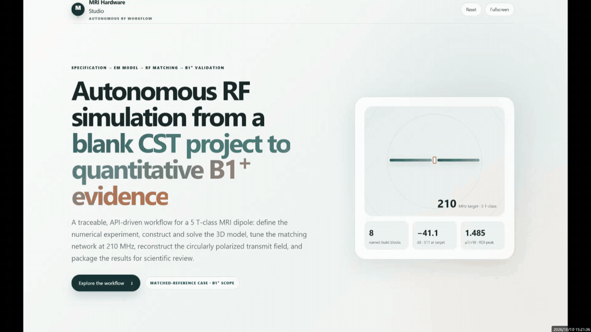

# MRI Hardware Studio

**An LLM-based agentic system for high-field MRI RF coil design and optimization.**

[](LICENSE)
[]()
[]()
[]()

**MRI Hardware Studio** is an LLM-based agent system targeting the full lifecycle of high-field MRI RF coil design and optimization — from coil topology selection and 3D EM modeling, through circuit co-simulation and B1⁺/SAR analysis, to automated parameter optimization and result reporting. The long-term vision is an AI co-engineer that can autonomously navigate the hardware design loop for MRI coils at any field strength.

**Current release (v1.0 — Phase 1)** delivers a set of foundational workflow skills that give an AI agent the structured knowledge to drive [CST Studio Suite](https://www.3ds.com/products/simulia/cst-studio-suite) through the [CST MCP server](external/CST-MCP): covering geometry modeling, solver setup, circuit matching, B1⁺/SAR post-processing, paper reproduction, and training data preparation.

---

## News 🔥

- **[2026-08]** `mri-coil-design-workflow` v1.0 released — end-to-end skill suite covering basic single-coil design, paper reproduction, and training data preparation pipelines.
- **[coming soon]** Technical report on arXiv — system design, benchmark results, and case studies.
- **[coming soon]** Demo videos: dipole-from-scratch and paper-reproduction workflows.

---

## Demos

### Demo 1 — Dipole Antenna from Scratch (7 T MRI)

> Build a fractionated dipole antenna for 7 T MRI (297 MHz) from an empty project: geometry → materials → ports → solver → circuit matching → B1⁺ post-processing — fully driven by the AI agent.

<!-- Replace with actual GIF once available -->


*Demo video / GIF coming soon.*

---

### Demo 2 — Paper Reproduction

> Reproduce simulation results from a published MRI coil paper end-to-end: literature parsing → baseline build → parameter sweep → B1⁺/SAR validation → final report.

<!-- Replace with actual GIF once available -->


*Demo video / GIF coming soon.*

---

## What's Inside

```
skills/
└── mri-coil-design-workflow/     # Main skill suite
    ├── SKILL.md                  # Skill entry point & routing logic
    ├── foundations/              # MRI physics, correctness rules, simulation SOP
    ├── driving/                  # CST/MCP operation rules, tool map, artifact pipeline
    ├── recipes/                  # Executable task workflows (inspect / build / B1-SAR / data-prep / repro)
    ├── building-blocks/          # Verified VBA blocks + Tier-B few-shot VBA knowledge
    ├── templates/                # Tier-A deterministic Jinja2 VBA templates
    ├── scripts/                  # Python tools: render / lint / execute / repair / postproc
    ├── pitfalls/                 # Known traps and deterministic error-fix signatures
    ├── notes/                    # Manual digests, reproduction logs, CST manual index
    └── design-notes/             # Roadmap research notes
```

### Skill Layers at a Glance

| Layer | Directory | Role |
|---|---|---|
| **Foundations** | `foundations/` | MRI physics, red-line rules, simulation SOP, result validation |
| **Driving** | `driving/` | CST/MCP tool map, parameter policy, artifact-first pipeline |
| **Recipes** | `recipes/` | Executable task workflows with clear inputs, steps, and validation gates |
| **Building blocks** | `building-blocks/` | Ground-truth VBA distilled from verified projects; Tier-B knowledge units |
| **Templates** | `templates/` | Tier-A Jinja2 VBA templates (zero LLM tokens at render time) |
| **Scripts** | `scripts/` | Reusable Python: render / lint / batch-execute / repair / B1⁺ / SAR / plot |
| **Pitfalls** | `pitfalls/` | Verified failure patterns and L2 error-fix signatures |
| **Notes** | `notes/` | CST manual digests, reproduction logs (repro-01 … repro-09) |

### Supported Workflows

| Mode | Entry Point |
|---|---|
| Inspect unknown `.cst` project | `recipes/inspect/inspect-unknown-project.md` |
| Build coil from scratch | `recipes/build/dipole-from-scratch.md` |
| B1⁺ field & SAR post-processing | `recipes/b1-sar/b1-field-pipeline.md` |
| Paper reproduction (end-to-end) | `recipes/paper-reproduction/orchestrator.md` |

---

## Quick Start

### Prerequisites

| Requirement | Details |
|---|---|
| **OS** | Windows (CST uses COM/`pythoncom`) |
| **CST Studio Suite** | 2024 or newer; license: HF Time Domain + HF Frequency Domain + Design Studio |
| **Python** | Recommended: **3.10** |
| **AI Agent** | [Claude Code](https://docs.claude.com/en/docs/claude-code/overview) or [OpenAI Codex](https://platform.openai.com/docs/codex) |
| **RAM** | ≥ 16 GB (32 GB+ recommended for lossy-body B1⁺ simulations) |

### Step 1 — Install Python dependencies

```bash
# Create a dedicated environment (Python 3.10 required)
conda create -n mri_agent python=3.10 -y
conda activate mri_agent

# Install MCP server and post-processing dependencies
pip install "mcp[cli]" anyio fastmcp numpy scipy matplotlib h5py
```

> **h5py is mandatory** for the B1⁺/SAR HDF5 post-processing pipeline. Missing it causes silent failures mid-run.

### Step 2 — Configure the CST MCP server

Point the MCP server at your CST installation via environment variables in your `.mcp.json`:

```json
{
  "mcpServers": {
    "cst-studio-suite": {
      "command": "python",
      "args": ["-m", "cst_mcp_server"],
      "env": {
        "CST_INSTALL_ROOT": "C:\\Program Files (x86)\\CST Studio Suite 2024",
        "CST_DESIGN_ENVIRONMENT_EXE": "C:\\Program Files (x86)\\CST Studio Suite 2024\\AMD64\\CST DESIGN ENVIRONMENT_AMD64.exe"
      }
    }
  }
}
```

See `skills/mri-coil-design-workflow/driving/mcp-setup.md` for full setup and verification steps.

### Step 3 — Register the skill in VS Code Copilot

Copy (or symlink) the skill into your agent skills directory:

```
# Place mri-coil-design-workflow under your VS Code skills folder:
# Windows: %APPDATA%\Code\User\prompts\  (or .agents/skills/ in your workspace)
```

In agent, the skill is auto-discovered by its YAML front matter in `SKILL.md`.

### Step 4 — Run your first workflow

Open agent and ask:

```
Build a dipole antenna from scratch, simulate it, tune the circuit, and show me the B1+ map.
```

The agent will route to `recipes/build/dipole-from-scratch.md` and execute the full pipeline.

---

## System Architecture

```
┌─────────────────────────────────────────────┐
│                Agent                        │
│  ┌─────────────────────────────────────┐    │
│  │   mri-coil-design-workflow skill    │    │
│  │  (decision layer: recipes, physics, │    │
│  │   artifact pipeline, pitfalls)      │    │
│  └──────────────┬──────────────────────┘    │
│                 │ MCP tool calls            │
│  ┌──────────────▼──────────────────────┐    │
│  │       CST MCP Server                │    │
│  │  (execution layer: VBA execution,   │    │
│  │   result reading, field export)     │    │
│  └──────────────┬──────────────────────┘    │
│                 │ COM / Python bindings     │
│  ┌──────────────▼──────────────────────┐    │
│  │     CST Studio Suite 2024           │    │
│  │  (EM solver, circuit solver,        │    │
│  │   field post-processing)            │    │
│  └─────────────────────────────────────┘    │
└─────────────────────────────────────────────┘
```

**Artifact-First Modeling Pipeline**

The skill uses a three-tier code generation strategy to minimize live CST round-trips:

| Tier | Method | Use case |
|---|---|---|
| **Tier A** | Jinja2 template rendering (`render_templates.py`) | Deterministic, known designs — zero LLM tokens |
| **Tier B** | Bounded few-shot generation from `building-blocks/vba-knowledge/` | New topologies from standard CST VBA units |
| **Tier C** | Agent reasoning | Genuine design decisions only (topology, tuning direction) |

All generated `.bas` files pass through `scripts/lint_vba.py` before execution. Batch execution is handled by `scripts/batch_execute.py` with L0–L4 error repair.

---

## Supported Coil Types & Frequencies

| Coil Type | B0 Field | Larmor Freq | Status |
|---|---|---|---|
| Fractionated dipole antenna | 5 T | 212.9 MHz | ✅ Validated |
| Fractionated dipole antenna | 7 T | 297 MHz | ✅ Validated |
| Single loop element | 3 T | 127.7 MHz | ✅ Validated |
| More basic coils | 3 T / 5 T | — | 🔄 In progress |
| Multi-channel RF array | 5 T | - | 📋 Planned |

---

## Reproduction Notes & Cases

The skill ships a `notes/` library containing distilled CST manual knowledge, simulation experience logs, and step-by-step reproduction records for 9 CST official reference antennas and MRI coils (`notes/repro-01` … `repro-09`), accumulated during the development of the system.

For paper-level reproduction, a full end-to-end case bundle is included under `skills/mri-coil-design-workflow/recipes/paper-reproduction/cases/`, currently featuring:

- **Raaijmakers et al. 2016 — Fractionated Dipole Antenna** (`cases/raaijmakers-2016-fractionated-dipole/`): paper brief, reproduction recipe, and demo-recording mode.


---

## Technical Report

> **Coming soon** — A technical report describing the system design, skill architecture, artifact-first pipeline, and benchmark results will be posted on arXiv.

```bibtex
@article{mri-hardware-studio-2026,
  title   = {MRI Hardware Studio: An AI-Native Skill Suite for MRI RF Coil Design and Simulation},
  author  = {[Authors]},
  journal = {arXiv preprint},
  year    = {2026},
  url     = {[arXiv link — coming soon]}
}
```

---

## Contributing

Contributions are welcome! See [CONTRIBUTING.md](CONTRIBUTING.md) for guidelines on:
- Adding new recipes
- Contributing VBA building blocks
- Reporting bugs in pitfalls

---

## License

[MIT](LICENSE)

---

## Acknowledgements

- [CST Studio Suite](https://www.3ds.com/products/simulia/cst-studio-suite) by Dassault Systèmes
- [CST MCP server](external/CST-MCP) — MCP interface for CST Studio Suite
- Inspired by [microsoft/ResearchStudio](https://github.com/microsoft/ResearchStudio)
