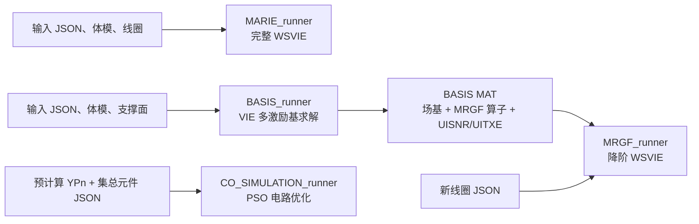

# MARIE 3.0 Runner 算法与使用指南

> 适用代码：当前本地 `marie-tools` 仓库（MARIE 3.0，2025）。
>
> 本文依据 `src/src_runners/` 及其直接调用的组装、求解和后处理源码整理。若以后更新仓库，应重新核对 Runner 文件。

## 1. Runner 是什么

Runner 是 MARIE 的顶层 MATLAB 脚本。它把输入读取、几何构造、积分方程组装、数值求解、电路联合仿真、场计算和结果保存串成一条完整工作流。

当前仓库实际包含 4 个 Runner：

| Runner | 主要任务 | 是否求解完整人体/线圈系统 | 典型耗时 | 主要输出 |
| --- | --- | --- | --- | --- |
| `MARIE_runner.m` | 完整 WSVIE 电磁仿真 | 是 | 高 | `MARIE_*.mat` |
| `BASIS_runner.m` | 生成电磁场基、MRGF 压缩算子、UISNR/UITXE | 对每个基函数求解 VIE | 很高 | `data/bases/<BasisFile>` |
| `MRGF_runner.m` | 使用预计算基进行降阶 WSVIE 仿真 | 使用降阶人体响应 | 中/低 | `MRGF_*.mat` |
| `CO_SIMULATION_runner.m` | 独立电路调谐、匹配、去耦优化 | 否 | 低至中 | `CoSimulation_*.mat` |

README 提到 `TMD_runner.m`，但当前 `src/src_runners/` 中没有该文件。当前可用的独立调谐/匹配入口是 `CO_SIMULATION_runner.m`；完整 MARIE 和 MRGF 流程也会调用 `co_simulation`。

## 2. 如何选择 Runner

```text
需要从线圈 + 体模直接得到 S 参数、B1、E 场、SNR？
  -> MARIE_runner

需要 UISNR、UITXE、理想电流模式，或准备 MRGF 基？
  -> BASIS_runner

同一个体模、频率和体素网格下，要反复评估不同线圈？
  -> 先 BASIS_runner，再 MRGF_runner

已有裸线圈 Y 参数，只想重新优化电容、电感、匹配和去耦？
  -> CO_SIMULATION_runner
```

四者的依赖关系如下：



## 3. 所有 Runner 的共同前置条件

### 3.1 MATLAB 环境

1. MATLAB 已安装且许可证服务器可用。
2. 已运行一次 `installer.m`，MEX 文件编译成功。
3. 每次新 MATLAB 会话先执行 `startup.m`。
4. 必须从仓库根目录运行，因为代码大量使用 `./data/...` 相对路径。

```matlab
cd('/home/<user>/marie-tools')
startup
```

建议先检查：

```matlab
which MARIE_runner
which BASIS_runner
which MRGF_runner
which CO_SIMULATION_runner
```

### 3.2 Runner 中的参数是硬编码的

各 Runner 开头都有 `close all; clearvars; clc`，随后直接定义输入文件名。因此不能先在工作区设置 `input_file` 来覆盖它。

不要直接修改仓库自带 Runner。复制一份到仓库根目录，并用 case 名称命名：

```bash
cd /home/<user>/marie-tools
cp src/src_runners/MARIE_runner.m RUN_MY_CASE.m
```

然后编辑副本中的 `input_file`。研究记录至少保留：

- Runner 副本；
- 输入 JSON；
- 被 JSON 引用的体模、线圈、屏蔽和基文件；
- MATLAB 日志；
- 输出 MAT 文件。

### 3.3 JSON 的共同输入契约

标准 JSON 包含以下键：

```json
{
  "B0": 5.0,
  "Nucleus": "1H",
  "Basis_Functions_VIE": "PWC",
  "BodyFile": "...",
  "CoilFile": "...",
  "WireFile": "...",
  "ShieldFile": "...",
  "SurfaceBasisSupportFile": "...",
  "TMD": 1,
  "BasisFile": "..."
}
```

字段的完整取值规则见 `MARIE_JSON文件配置指南.md`。不同 Runner 会忽略其中一部分字段，详见下文。

## 4. `MARIE_runner`: 完整 WSVIE 仿真

### 4.1 具体用途

这是常规线圈仿真的首选入口，适用于：

- 给定体模和实际线圈，计算端口网络参数；
- 计算 Rx 接收场、Tx 发射场、电场；
- 计算阵列 SNR 和 Tx efficiency；
- 在线圈 JSON 已定义可调集总元件时执行自动调谐、匹配和去耦；
- 同时包含表面线圈、导线线圈和屏蔽体的耦合问题。

如果只是第一次跑案例，或者尚未生成兼容的 MRGF 基，应使用它。

### 4.2 算法原理

MARIE 将系统划分为三类离散未知量：

- WIE：细导线上的电流未知量；
- SIE：表面导体/屏蔽上的表面电流未知量；
- VIE：有损介质体模体素中的极化电流未知量。

组装后的耦合系统可概念性写为：

```text
[ Z_coil   Z_coil-body ] [ J_coil ]   [ V_port ]
[ Z_body-coil Z_body   ] [ J_body ] = [    0   ]
```

这里的 `Z_coil` 可进一步包含 WIE、SIE、屏蔽体及它们之间的耦合块。VIE 的体积分算子通过卷积型矩阵向量乘法实现，避免显式存储完整稠密体矩阵；线圈与体模耦合矩阵使用低秩表示。求解器对每个激励端口调用带预条件的迭代 GMRES，优先尝试 GPU，显存不足时降级，最终可退回 CPU。

源码主调用链：

```text
load_inputs
  -> geo_assembly
  -> wsvie_assembly
       -> wie_assembly
       -> sie_assembly
       -> shield_sie_assembly
       -> vie_assembly
       -> wsvie_coupling_assembly
  -> solver_wsvie
       -> rhs_assembly
       -> prec_wsvie
       -> is_gmres_svie (逐端口)
       -> np_compute
  -> co_simulation
  -> em_ehfield_wsvie
  -> save
```

### 4.3 前置条件

- `BodyFile` 必须是可读取的 MARIE phantom；
- `Basis_Functions_VIE` 必须与当前模型和 MEX 支持一致，通常为 `PWC` 或 `PWL`；
- `CoilFile`、`WireFile`、`ShieldFile` 中至少应有一个提供实际结构和端口；
- 如果 `TMD=1`，线圈 JSON 必须正确标出可优化集总元件、端口类型及优化边界；
- 自动调谐使用 `particleswarm`，需要 MATLAB Global Optimization Toolbox；
- 大模型需要足够 RAM，GPU 不是硬性要求，但可显著加速部分运算。

### 4.4 输入

Runner 当前默认：

```matlab
input_file = 'inp_MSphere_HeadCoil1z.json';
```

需要在副本中替换为自己的 JSON 文件名。JSON 应放在 `data/inputs/`，因为 `load_inputs` 按项目约定查找该目录。

与此 Runner 相关的字段：

| 字段 | 作用 |
| --- | --- |
| `B0`, `Nucleus` | 决定拉莫尔频率和电磁常数 |
| `Basis_Functions_VIE` | 体模电流离散阶次 |
| `BodyFile` | 体模介电参数和体素网格 |
| `CoilFile` | SIE 表面线圈 |
| `WireFile` | WIE 导线线圈 |
| `ShieldFile` | SIE 屏蔽体 |
| `TMD` | 是否执行调谐/匹配/去耦联合仿真 |
| `BasisFile` | 仅在没有显式线圈/导线/屏蔽且以外部基激励时使用 |
| `SurfaceBasisSupportFile` | 普通 MARIE 仿真通常不使用 |

### 4.5 使用方法

交互式运行：

```matlab
cd('/home/<user>/marie-tools')
startup
RUN_MY_CASE
```

批处理运行并记录日志：

```bash
cd /home/<user>/marie-tools
export MLM_LICENSE_FILE=27000@<license-server>
~/MATLAB/R2025b/bin/matlab -batch "startup; RUN_MY_CASE" \
  > logs/RUN_MY_CASE.log 2>&1
```

成功标志：

```text
[MARIE 3.0] Simulation completed successfully.
[Saved] - ./data/solutions/MARIE_<TMD>_<case>.mat
```

### 4.6 输出

Runner 只保存 `MREDM.fields`，顶层变量名是 `solution`：

```matlab
solution = MREDM.fields;
save(..., 'solution', '-v7.3');
```

常见字段：

| 字段 | 含义 |
| --- | --- |
| `solution.Jcb` | 联合求解得到的线圈/屏蔽电流系数 |
| `solution.JcbRx`, `JcbTx` | 联合仿真校准后的 Rx/Tx 电流系数，是否存在取决于线圈类型 |
| `solution.netp.YP_s` | 调谐匹配后的端口导纳矩阵 |
| `solution.netp.ZP_s` | 端口阻抗矩阵 |
| `solution.netp.SP_s` | 工作频率处 S 参数矩阵 |
| `solution.netp.SP_p` | 另一工作状态/去谐状态的 S 参数，含义取决于线圈类型 |
| `solution.netp.figure_freq` | 频率扫描绘图数据 |
| `solution.e_field` | 电场结果，通常分 `Rx`/`Tx` 子结构 |
| `solution.h_field` | 磁场及 B1 结果，通常分 `Rx`/`Tx` 子结构 |
| `solution.snr_field` | 接收 SNR 及相关噪声结果 |
| `solution.txe_field` | 发射效率结果 |

对于含多个临时调谐端口的阵列，`Jcb`列数可以大于最终物理通道数，而`JcbRx/JcbTx`列数应与
最终物理通道一致。Stage B后续固定电路场计算必须使用已验收的校准电流；不得把物理端口
`YP_s`与临时端口`Jcb`再次送入matching-only校准。

其中 `solution.txe_field.TXE` 是由最优 `B1+` 与总损耗矩阵构成的最大特征值，即平方型发射效率指标。常见的 `B1+ / sqrt(W)` 图应绘制 `1e6*sqrt(max(real(TXE),0))`，单位为 `µT/sqrt(W)`。详细代码见 `MARIE_可视化脚本使用指南.md` 第 10.4 节。

不要假定所有子字段都存在。纯 Rx 模型出现 `e_field.Rx` 而没有 `e_field.Tx` 是正常的：

```matlab
R = load('data/solutions/MARIE_1_my_case.mat', 'solution');
fieldnames(R.solution)
fieldnames(R.solution.e_field)
```

### 4.7 局限与注意事项

- 计算和内存成本最高，体素变细、端口增多、PWL 基都会显著增加成本；
- 输出不包含完整 `MREDM`，因此仿真关闭后无法仅靠结果 MAT 恢复全部几何和算子；
- `TMD=1` 可能把优化后的集总元件值回写线圈 JSON，运行前应备份线圈文件；
- 迭代收敛不等于物理模型正确，仍需检查 S 参数、阻抗、场分布和能量量级。

## 5. `BASIS_runner`: 场基、UISNR 和 MRGF 算子生成

### 5.1 具体用途

该 Runner 有两个目标：

1. 计算与具体接收线圈无关的极限指标：UISNR、UITXE 及其最优权重；
2. 为同一体模的后续 `MRGF_runner` 生成可复用的总场基和压缩人体响应算子。

它不是普通线圈仿真的替代品。生成基通常是一次性、高成本预计算；只有计划对同一体模反复评估多个线圈时，MRGF 加速才有意义。

### 5.2 两种基及算法原理

Runner 用 `geo_flag` 选择激励基：

| `geo_flag` | 基类型 | 生成函数 | 用途 |
| --- | --- | --- | --- |
| `2` | 表面支撑基 | `sSVD_rwgBasis` | 在给定支撑面上形成理想表面电流模式，可输出理想线圈电流 |
| `3` | 偶极子支撑基 | `rSVD_dipoleBasis` | 用围绕体模的偶极子激励逼近完备外部场空间，适合 ultimate metrics |

核心步骤是：

1. 构造一组入射电场/磁场基 `Ue`、`Ub`；
2. 对每个基向量求解人体 VIE，得到极化电流响应 `Jb`；
3. 将散射场加回入射场，形成总场基；
4. 从人体损耗构造噪声协方差矩阵 `phi`；
5. 对每个体素求最优接收组合，得到 UISNR 和权重 `wUISNR`；
6. 求最大 B1+ 模式，得到 UITXE 和权重 `wUITXE`；
7. 对投影后的人体逆响应做经济型 SVD，保存 MRGF 所需压缩因子。

UISNR 的计算本质上是噪声白化后的最优线性组合。对目标体素灵敏度向量 `s` 和噪声协方差 `Phi`，其核心量为：

```text
UISNR proportional to sqrt(s^H * Phi^(-1) * s)
```

源码还对逐渐增加的模式数计算 `cUISNR/cUITXE`，用于观察基截断是否收敛。

### 5.3 前置条件

- 必须提供 `BodyFile`；
- `BasisFile` 必须非空，并指向可写的 `data/bases/` 文件；
- `geo_flag=2` 时必须提供兼容的 `SurfaceBasisSupportFile`；
- `geo_flag=3` 时支撑面字段不参与偶极子基生成；
- `CoilFile`、`WireFile`、`ShieldFile` 和 `TMD` 在该流程中不是普通实际线圈输入；
- 需要大量 RAM、磁盘和计算时间；每个基向量都要执行一次 VIE GMRES；
- `PWC`、较粗网格和较少模式适合先做流程验证。

### 5.4 输入设置

Runner 当前硬编码：

```matlab
input_file = 'inp_Duke_StadiumTriangular.json';
geo_flag   = 2;
```

在副本中同时修改这两项。例如生成球体的表面支撑基：

```matlab
input_file = 'inp_MSphere_MyBasis.json';
geo_flag   = 2;
```

输入 JSON 中最关键的字段：

```json
{
  "B0": 5.0,
  "Nucleus": "1H",
  "Basis_Functions_VIE": "PWC",
  "BodyFile": "MySphere.mat",
  "CoilFile": "",
  "WireFile": "",
  "ShieldFile": "",
  "SurfaceBasisSupportFile": "MySupport.msh",
  "TMD": 0,
  "BasisFile": "BASIS_5T_MySphere_PWC.mat"
}
```

### 5.5 使用方法

```matlab
cd('/home/<user>/marie-tools')
startup
RUN_BASIS_MY_CASE
```

成功后输出位置由 `BasisFile` 决定，而不是 `data/solutions/`：

```text
data/bases/BASIS_5T_MySphere_PWC.mat
```

### 5.6 输出

顶层变量名为 `BASIS`。常见字段如下：

| 字段 | 含义 |
| --- | --- |
| `Ue`, `Ub` | 总电场基和总磁场基 |
| `X` | 基变换/压缩映射 |
| `SK`, `VK`, `P` | 入射基构造中的分解或投影因子，具体存在性依基类型而定 |
| `U_hat_inv`, `S_hat_inv`, `V_hat_inv` | 降阶人体逆响应的 SVD 因子，供 MRGF 使用 |
| `phi` | 模式噪声协方差矩阵 |
| `UISNR` | 完整模式集合的 ultimate intrinsic SNR 三维图 |
| `cUISNR` | 随模式数增加的 UISNR 收敛数据 |
| `wUISNR` | 各体素达到 UISNR 的最优模式权重 |
| `UITXE` | ultimate intrinsic transmit efficiency 三维图 |
| `cUITXE` | 随模式数增加的 UITXE 收敛数据 |
| `wUITXE` | 各体素的最优发射模式权重 |
| `nmodes` | 收敛曲线所用模式数 |
| `Substrate` | 仅 `geo_flag=2`：表面支撑网格，可用于理想电流可视化 |

检查基文件：

```matlab
B = load('data/bases/BASIS_5T_MySphere_PWC.mat', 'BASIS');
fieldnames(B.BASIS)
size(B.BASIS.Ue)
size(B.BASIS.UISNR)
```

### 5.7 局限与注意事项

- 基文件与 `B0`、核素、体模材料、体素网格、分辨率和 PWC/PWL 离散绑定；
- 任何上述条件改变后，不应继续复用旧基；
- `inv` 和逐体素特征值计算可能占用大量内存和时间；
- `geo_flag=2` 才保存 `Substrate`，没有它就不能按表面网格直接显示理想电流模式；
- 基文件是重要中间资产，删除后重建代价可能高于普通仿真。

## 6. `MRGF_runner`: 基于预计算人体响应的降阶仿真

### 6.1 具体用途

MRGF 用于在人体/体模保持不变时反复分析不同线圈结构、位置或集总元件。典型流程是：

1. 对固定体模和频率运行一次 `BASIS_runner`；
2. 保留生成的基文件；
3. 对多个线圈分别运行 `MRGF_runner`；
4. 通过降阶人体响应避免每次重新求解完整 VIE。

它适合线圈设计扫描、参数优化和多构型比较。对于只跑一次的模型，生成基的成本可能得不偿失。

### 6.2 算法原理

完整系统中，消去人体未知量后，线圈端看到的人体加载可写成 Schur 补形式：

```text
Z_eff = Z_coil + Z_body-coil^T * Z_body^(-1) * Z_body-coil
```

MRGF 不直接构造和求逆巨大的 `Z_body`，而是用 BASIS 阶段预计算的压缩因子近似其作用。源码中的核心表达式为：

```matlab
U_hat_inv * (S_hat_inv * (V_hat_inv' * ZbcN))
```

然后构造降阶后的有效线圈阻抗 `Zss`，使用 MATLAB 反斜杠直接解线圈系统：

```matlab
Jcb = Zss \ rhs;
```

人体场系数通过 `X` 从线圈-人体耦合投影得到，最终用预计算总场基恢复电磁场：

```text
a -> Ue * a 产生电场
a -> Ub * a 产生磁场
```

因此主要加速来自“人体响应只预计算一次，后续线圈只在压缩空间求解”。

### 6.3 支持的结构组合

当前 `ie_solver_svie_mrgf.m` 明确实现：

- 表面线圈；
- 导线线圈；
- 表面线圈 + 导线线圈；
- 表面线圈 + 屏蔽体；
- 导线线圈 + 屏蔽体；
- 表面线圈 + 导线线圈 + 屏蔽体。

至少应存在一种线圈结构；只有屏蔽体而没有线圈的分支未实现。

### 6.4 前置条件

`BasisFile` 必须是 MATLAB v7.3/HDF5 文件，并包含以下路径：

```text
/BASIS/Ue
/BASIS/Ub
/BASIS/U_hat_inv
/BASIS/S_hat_inv
/BASIS/V_hat_inv
/BASIS/X
```

最重要的兼容条件：

- MRGF JSON 与 BASIS JSON 的 `B0`、`Nucleus` 一致；
- `BodyFile` 及其体素尺寸、分辨率、材料参数一致；
- `Basis_Functions_VIE` 一致；
- 基文件不是中断、损坏或来自其他 body case；
- 新线圈位于基函数能够有效表征的空间区域内；
- 至少提供 `CoilFile`、`WireFile` 中之一，可按需增加 `ShieldFile`。

仅仅字段尺寸碰巧相同，不代表物理兼容。

### 6.5 输入与使用方法

Runner 当前硬编码：

```matlab
input_file = 'inp_Duke_ProstateLinacCoil.json';
```

MRGF JSON 中的 `BasisFile` 应填写 BASIS 阶段生成的文件名。运行：

```matlab
cd('/home/<user>/marie-tools')
startup
RUN_MRGF_MY_COIL
```

运行前可验证必需数据集：

```matlab
basisFile = fullfile(pwd, 'data', 'bases', 'BASIS_5T_MySphere_PWC.mat');
info = h5info(basisFile, '/BASIS');
string({info.Datasets.Name})'
```

### 6.6 输出

保存文件：

```text
data/solutions/MRGF_<input-json-basename>.mat
```

顶层变量仍是 `solution`，主要字段与 `MARIE_runner` 相同，另外可见：

| 字段 | 含义 |
| --- | --- |
| `solution.a` | 降阶人体场系数 |
| `solution.aRx`, `aTx` | 联合仿真校准后的 Rx/Tx 降阶系数，按线圈类型出现 |

其余常见字段包括 `Jcb`、`JcbRx/JcbTx`、`netp`、`e_field`、`h_field`、`snr_field`、`txe_field`。

### 6.7 如何验证 MRGF 是否可信

首次建立某类模型时，应选择一个较小案例同时运行 MARIE 和 MRGF，并比较：

```matlab
A = load('data/solutions/MARIE_1_case.mat', 'solution');
B = load('data/solutions/MRGF_case.mat', 'solution');

relS = norm(A.solution.netp.SP_s - B.solution.netp.SP_s, 'fro') / ...
       norm(A.solution.netp.SP_s, 'fro');
fprintf('S 参数相对差异 = %.3e\n', relS)
```

还应比较 B1 场和 SNR 的 ROI 均值、最大值及空间差异。不能只凭“程序成功结束”判定降阶精度。

## 7. `CO_SIMULATION_runner`: 独立电路联合仿真

### 7.1 具体用途

该 Runner 不重新计算几何、电磁积分算子或人体场。它用于已经有裸线圈端口导纳矩阵 `YPn` 时，快速重新设计：

- 调谐电容/电感；
- 50 ohm 匹配；
- 多通道 Tx 去耦；
- Rx 前置放大器去耦；
- TxRx 线圈的发射/接收状态和失谐状态。

适合修改电路参数，不适合修改导体几何、线圈位置或体模。几何变化会改变 `YPn`，必须先重新做电磁求解。

### 7.2 算法原理

Runner 把电磁求解得到的裸线圈多端口导纳矩阵与线圈 JSON 中的 R/L/C、互感、匹配和端口定义组合。内部通过网络消元得到端口等效导纳，例如使用 Schur 补：

```text
Y_port = Y_MM - Y_MN * inv(Y_NN) * Y_NM
```

优化器使用 MATLAB `particleswarm`。当前默认参数包括：

- 粒子数 `300`；
- 第一阶段最多 `500` 次迭代；
- 第二阶段最多 `400` 次迭代；
- 目标函数容差分别为 `1e-5` 和 `1e-2`；
- `UseParallel=false`。

根据 JSON 中每个可调元件的 `TxRx` 类型，代码选择 Rx、Tx、TxRx 或混合阵列对应的优化函数。优化后计算校准矩阵 `M_cal`，用于把裸线圈电流/场映射为调谐匹配后的端口电流/场。

### 7.3 前置条件

- Global Optimization Toolbox，可调用 `particleswarm`；
- `YPn_mat` 中必须存在变量名完全为 `YPn` 的方阵；
- `YPn` 的节点顺序、维度必须与线圈 JSON 中的节点和集总元件定义一致；
- `B0` 和核素对应的工作频率必须与生成 `YPn` 时一致；
- 线圈 JSON 必须包含完整 RLC、端口、激励类型、可调标志和上下界；
- 若后续使用 `M_cal` 校准场，裸场数据必须与同一个 `YPn` 和端口排序对应。

Runner 注释写“需要预计算 EM fields 和 Y 参数”，但实际脚本只直接加载 `YPn` 和线圈 JSON。它本身不会读取或输出 E/B/SNR 场；场校准需要在其他脚本中用 `M_cal` 处理与该 Y 矩阵对应的裸场。

### 7.4 输入

该 Runner 不使用标准输入 JSON，而是在脚本中硬编码：

```matlab
B0            = 7.0037;
YPn_mat       = 'YPn_mat.mat';
coil_file_inp = 'Head_Receive_Array_31_Coils_CST.json';
```

当前代码还将核素硬编码为：

```matlab
emc = em_constants(B0, '1H');
```

文件位置固定为：

```text
data/coils/external_coils/<YPn_mat>
data/coils/external_coils/<coil_file_inp>
```

使用其他核素时，必须同时修改 `em_constants` 的第二个参数。

### 7.5 使用方法

1. 复制 Runner；
2. 修改 `B0`、核素、`YPn_mat` 和 `coil_file_inp`；
3. 备份线圈 JSON，因为优化值会被回写；
4. 运行副本。

```matlab
cd('/home/<user>/marie-tools')
startup
RUN_COSIM_MY_COIL
```

### 7.6 输出

保存文件：

```text
data/solutions/CoSimulation_<coil-json-basename>.mat
```

顶层变量为 `solution`，包含：

| 字段 | 含义 |
| --- | --- |
| `solution.netp.YP_s` | 优化后的端口导纳矩阵 |
| `solution.netp.ZP_s` | 优化后的端口阻抗矩阵 |
| `solution.netp.SP_s` | 工作状态 S 参数 |
| `solution.netp.SP_p` | 去谐/另一状态 S 参数，取决于线圈类型 |
| `solution.netp.figure_freq` | 频率扫描及绘图数据 |
| `solution.M_cal` | 从裸 EM 端口解到优化电路端口解的校准矩阵或 Rx/Tx 子结构 |

此外，`geo_scoil_print_lumped_elements` 会把优化后的集总元件值写回线圈 JSON。MAT 结果和 JSON 都属于输出。

### 7.7 局限与注意事项

- PSO 是随机全局优化，重复运行可能得到略有不同的元件值；正式分析应设置并记录随机种子 `rng(seed)`；
- 粒子群成功停止不保证得到可制造电容值，应检查元件范围、Q 值、S 参数带宽和鲁棒性；
- `YPn` 与 JSON 节点顺序不一致会产生“数值可运行但物理错误”的危险结果；
- 该 Runner 只做电路层，不输出接收场、SNR 或 SAR；
- 线圈几何或人体位置变化后不能复用旧 `YPn`。

## 8. 输入输出对照表

| 项目 | MARIE | BASIS | MRGF | CO_SIMULATION |
| --- | --- | --- | --- | --- |
| 标准输入 JSON | 是 | 是 | 是 | 否 |
| 体模 | 必需 | 必需 | 必需且须匹配基 | 不直接读取 |
| 实际线圈 | 至少一种结构 | 忽略普通实际线圈 | 至少一种结构 | 集总元件 JSON |
| 表面基支撑 | 通常不用 | flag 2 必需 | 不使用 | 不使用 |
| 预计算 BASIS | 通常不需要 | 生成 | 必需 | 不需要 |
| 预计算 YPn | 内部计算 | 不需要 | 内部计算 | 必需 |
| 完整 VIE 求解 | 是 | 每个基模式一次 | 否 | 否 |
| 电路 PSO | `TMD=1` 时 | 否 | `TMD=1` 时 | 是 |
| S 参数 | 是 | 否 | 是 | 是 |
| E/B 场 | 是 | 场基 | 是 | 否 |
| 阵列 SNR | 是 | UISNR | 是 | 否 |
| UISNR/理想权重 | 否 | 是 | 从基文件读取而非重新生成 | 否 |

## 9. 推荐工作流

### 9.1 单个线圈项目

```text
制作/选择体模和线圈
-> 编写 JSON
-> 复制 MARIE_runner
-> 小网格试运行
-> 检查 S 参数和场
-> 正式分辨率运行
-> 保存 JSON、Runner、日志和 MAT
```

### 9.2 UISNR 与实际线圈性能比较

```text
BASIS_runner 生成 UISNR
-> MARIE_runner 生成实际阵列 SNR
-> 在相同体素、单位、带宽和归一化下计算 SNR/UISNR
```

不要直接比较来自不同体模网格或不同频率的两张归一化图片。

### 9.3 多线圈快速扫描

```text
固定 B0、核素、体模和 VIE 网格
-> BASIS_runner 一次
-> MRGF_runner 对多个线圈重复
-> 选一个代表案例用 MARIE_runner 交叉验证
```

### 9.4 只改电容和匹配网络

```text
固定几何和 YPn
-> 复制 CO_SIMULATION_runner
-> 修改电路 JSON
-> PSO 优化
-> 检查 SP_s、figure_freq 和元件值
-> 必要时使用 M_cal 校准对应裸场
```

## 10. 运行前后的最小检查

### 10.1 运行前

```matlab
cd('/home/<user>/marie-tools')
startup
assert(exist('data/inputs/inp_my_case.json', 'file') == 2)
license('test', 'Distrib_Computing_Toolbox')
license('test', 'GADS_Toolbox')   % particleswarm 对应工具箱许可
```

对于 MRGF：

```matlab
h5info('data/bases/my_basis.mat', '/BASIS/Ue');
h5info('data/bases/my_basis.mat', '/BASIS/U_hat_inv');
```

对于独立联合仿真：

```matlab
Y = load('data/coils/external_coils/YPn_mat.mat', 'YPn');
assert(isfield(Y, 'YPn'))
assert(size(Y.YPn,1) == size(Y.YPn,2))
```

### 10.2 运行后

```matlab
whos('-file', resultFile)
R = load(resultFile, 'solution');
fieldnames(R.solution)

if isfield(R.solution, 'netp')
    S = R.solution.netp.SP_s;
    assert(all(isfinite(S(:))))
    disp(20*log10(abs(diag(S))))
end
```

BASIS 文件：

```matlab
B = load(basisFile, 'BASIS');
assert(all(isfinite(B.BASIS.UISNR(:))))
assert(all(size(B.BASIS.phi,1) == size(B.BASIS.phi,2)))
```

## 11. 常见错误定位

| 现象 | 常见原因 | 首要检查 |
| --- | --- | --- |
| 找不到输入文件 | MATLAB 当前目录错误或 JSON 不在约定目录 | `pwd`, `exist(...)` |
| MEX `GLIBCXX` 错误 | MEX 使用了比 MATLAB 自带 `libstdc++` 更新的 ABI | 用兼容 GCC 重编译所有 MEX |
| `particleswarm` 未定义 | 缺少 Global Optimization Toolbox | `which particleswarm`, `ver` |
| MRGF `h5read` 找不到数据集 | BASIS 文件不完整、版本不兼容或路径错误 | `h5info(basisFile,'/BASIS')` |
| MRGF 尺寸不一致 | 基与当前体模/离散不匹配 | 比较两个 JSON 和 body 网格 |
| BASIS 内存不足 | 模式过多、PWL 或体素过细 | 先用 PWC/粗网格和小支撑面 |
| 只有 Rx 字段、访问 Tx 报错 | 模型是纯接收线圈 | 先 `fieldnames(...)` |
| CO_SIM 可运行但结果异常 | YPn 节点顺序与 JSON 不一致 | 核对端口/节点映射和矩阵维度 |
| 输出文件不存在 | Runner 在保存前报错或目录不可写 | 查看日志最后一条错误和 `data/solutions` 权限 |

## 12. 源码索引

核心入口：

```text
src/src_runners/MARIE_runner.m
src/src_runners/BASIS_runner.m
src/src_runners/MRGF_runner.m
src/src_runners/CO_SIMULATION_runner.m
```

关键实现：

```text
src/src_integral_equations/wsvie_assembly.m
src/src_integral_equations/wsvie_assembly_mrgf.m
src/src_integral_equations/src_basis/IncidentField_Basis.m
src/src_solver/src_ie_solver/solver_wsvie.m
src/src_solver/src_ie_solver/ie_solver_wsvie/ie_solver_wsvie.m
src/src_solver/src_ie_solver/ie_solver_vie/ie_solver_vie_basis.m
src/src_solver/src_ie_solver/ie_solver_svie/ie_solver_svie_mrgf.m
src/src_physics/src_electromagnetism/em_ehfield_vie.m
src/src_physics/src_electromagnetism/em_ehfield_wsvie_mrgf.m
src/src_physics/src_electronics/co_simulation/
```

---

结论：常规项目从 `MARIE_runner` 开始；只有明确需要 UISNR/理想模式或同一体模的批量线圈扫描时，才投入成本生成 BASIS；`CO_SIMULATION_runner` 是电路优化工具，不是电磁场求解器。
