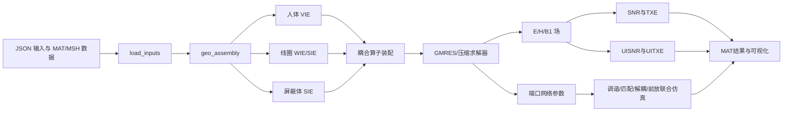

# MARIE Tools 项目架构剖析报告

## 1. 调研对象与结论摘要

- 项目：MARIE Tools
- 上游仓库：<https://github.com/cloudmrhub/marie-tools>
- 本地目录：`C:\path\to\marie-tools`
- 调研版本：`d2d6f5efb933be1399fb3346a10bc910f2cd1ba6`
- 提交日期：2026-07-27
- 许可证：MIT
- 分析方式：源码、示例输入、数据资产和 MATLAB 路径解析的静态分析；未编译 MEX，未执行完整电磁仿真。

MARIE Tools 是一个面向 MRI 射频线圈分析的 MATLAB 电磁计算平台。它以体积分方程（VIE）、表面积分方程（SIE）、线积分方程（WIE）及其耦合形式为核心，可同时描述人体介质、导体表面、细导线线圈和屏蔽体，并在求解后计算场分布、接收 SNR、发射效率，以及理想电流模式对应的 UISNR/UITXE。

项目最有价值的架构思想不是某个单独求解器，而是以下完整链条：

1. 将人体、线圈、屏蔽体和端口统一装配到积分方程模型中。
2. 将“昂贵的全波人体响应”压缩成可复用的基函数或磁共振格林函数（MRGF）。
3. 在同一噪声协方差框架下比较有限线圈阵列 SNR 与理想基函数空间 UISNR。
4. 从最优权重反推出理想电流模式，为线圈几何和阵列布局提供设计方向。
5. 将电磁模型与匹配、调谐、解耦和前置放大器网络联合仿真连接起来。

它非常适合作为 Python UISNR/高场接收线圈设计软件的算法与分层架构参考，但当前仓库存在路径遮蔽、入口脚本与示例数据不完全一致、数值约定未显式集中管理、测试不足等工程问题，不宜原样移植。

## 2. 仓库规模与目录概览

当前检出版本约有 1477 个受 Git 跟踪的文件，工作区约 190 MB。主要文件类型如下：

| 类型 | 数量 | 作用 |
|---|---:|---|
| MATLAB `.m` | 813 | 主体算法、入口脚本、数据装配和可视化 |
| C++ `.cpp` | 128 | 积分计算与性能关键 MEX 内核 |
| MEX 二进制 | 77 | 部分平台的预编译计算内核 |
| Gmsh `.msh` | 34 | 线圈、屏蔽体和支撑面的网格 |
| JSON | 20 | 输入配置与电路/端口描述 |
| MAT | 13 | 人体模型、材料和预计算数据 |

```text
marie-tools/
├── data/
│   ├── bases/                 # 预计算基函数数据（当前检出内容近乎为空）
│   ├── bodies/                # 球模型、人体模型及介电参数
│   ├── coils/                 # 导线、表面线圈、屏蔽体及端口数据
│   ├── inputs/                # JSON 仿真输入
│   └── solutions/             # 仿真输出目录
├── src/
│   ├── src_geometry/          # 几何、网格、材料与基函数支撑域
│   ├── src_integral_equations/# WIE/SIE/VIE 及耦合算子
│   ├── src_mathematics/       # SVD、张量压缩、积分和第三方数学库
│   ├── src_physics/           # 电磁场、SNR/TXE、网络与联合仿真
│   ├── src_runners/           # 四个顶层工作流入口
│   ├── src_solver/            # GMRES、预条件器和矩阵向量乘
│   ├── src_utils/             # 输入、数据加载、变换和导出
│   └── src_visualizer/        # 场、几何及理想电流可视化
├── installer.m                # MEX 编译安装器
├── startup.m                  # 递归加入 MATLAB 搜索路径
└── README.md
```

## 3. 总体架构



系统使用一个可变结构体 `MREDM` 作为跨模块数据总线。其典型字段包括：

| 字段 | 内容 |
|---|---|
| `inputs` | 文件路径、频率、核种、求解选项和容差 |
| `emc` | 频率、角频率、波数、温度、平衡磁化强度等常数 |
| `dimensions` | 体素网格和未知量尺寸 |
| `EP` | 人体介电参数与体素掩膜 |
| `functions` | 根据模型类型动态选择的函数句柄 |
| `operators` | VIE/SIE/WIE、自耦与互耦算子 |
| `solver` | 右端项、预条件器、迭代结果和网络参数 |
| `fields` | 电磁场、B1、SNR、TXE 和最优权重 |
| `SIE` / `WIE` | 表面与导线未知量、端口及网格 |
| `BASIS` | 理想模式或 MRGF 所需压缩基 |

这种设计让研究代码可以快速增加字段和串联实验，但类型边界、单位约定和必填字段主要依赖调用顺序。若用 Python 重构，更合适的方式是将其拆成有验证能力的数据类，例如 `SimulationConfig`、`GeometryModel`、`OperatorSet`、`FieldSolution`、`NoiseModel` 和 `CoilMetrics`。

## 4. 四条顶层工作流

### 4.1 完整线圈—人体耦合：MARIE_runner

`src/src_runners/MARIE_runner.m` 是有限尺寸线圈分析的主入口：

```text
load_inputs
  -> geo_assembly
  -> wsvie_assembly
  -> solver_wsvie
  -> co_simulation
  -> em_ehfield_wsvie
  -> 保存结果
```

它组合 WIE、SIE 和 VIE：导线线圈可采用 WIE，导体表面/屏蔽体采用 SIE，人体介质采用 VIE，随后建立相互耦合。输出不仅包含 E/H/B1 场，还包含端口网络、样品噪声、线圈损耗、集总元件损耗以及最终阵列 SNR。

### 4.2 理想基与 UISNR：BASIS_runner

`src/src_runners/BASIS_runner.m` 用于生成理想电流分析所需的场基：

```text
人体与支撑域几何
  -> IncidentField_Basis
  -> ie_solver_vie_basis
  -> em_ehfield_vie
  -> UISNR/UITXE、收敛曲线、最优权重
  -> 保存基数据
```

它支持两类候选源空间：

- 表面 RWG 基：电流受实际线圈支撑面约束，更接近可制造结构。
- 包围人体的偶极子/壳层基：源空间更宽，可用于逼近终极性能上界。

`IncidentField_Basis` 对候选激励产生的入射场做随机或结构化 SVD 压缩，再通过 DEIM 选取有代表性的源位置/模式。`ie_solver_vie_basis` 对每个压缩基求人体散射响应，最终形成总场基和噪声协方差。

### 4.3 MRGF 快速复用：MRGF_runner

`src/src_runners/MRGF_runner.m` 载入预计算的 `Ue`、`Ub`、压缩逆算子和耦合映射 `X`，避免在每次候选线圈评估时重新完成全部人体 VIE 求解。

其思想可概括为：


这是项目中最值得用于 CST 前端预仿真的架构：人体响应在离线阶段计算，候选线圈的快速筛选在降阶空间进行，仅将少量优选方案送入 CST 全波验证。

### 4.4 电路联合仿真：CO_SIMULATION_runner

`src/src_runners/CO_SIMULATION_runner.m` 基于预计算导纳/阻抗参数，通过粒子群等方法处理：

- 线圈调谐；
- 端口匹配；
- 阵列去耦；
- 前置放大器去耦；
- 电路元件损耗与噪声贡献。

该模块体现了一个重要边界：电磁最优电流不等于可实现阵列性能。几何耦合、匹配网络、元件 Q 值、前置放大器阻抗和导体损耗都应进入有限阵列 SNR 评估。

## 5. 积分方程与数值计算层

### 5.1 几何与离散

`src/src_geometry` 负责：

- 读取体素人体及组织电参数；
- 读取 Gmsh 线网格和三角面网格；
- 生成导线、表面和屏蔽体离散；
- 创建理想电流源的支撑面或包围壳层；
- 为 pFFT 建立扩展规则网格；
- 读取与端口相邻的集总元件 JSON。

体素人体非常适合 VIE，因为介质未知量可映射到规则网格，并利用卷积、FFT 和低秩张量压缩加速。导体和细线则分别采用表面或线基函数，避免对空气区域做体网格剖分。

### 5.2 算子装配

`src/src_integral_equations` 是规模最大的领域层之一，包含：

- VIE：人体介质极化电流与体场响应；
- SIE：表面导体/屏蔽体电流；
- WIE：细导线线圈电流；
- WVIE、SVIE、WSVIE、WSIE 等耦合形式；
- RWG、PWC、PWL 等基函数；
- pFFT、卷积核和近远场分离；
- 基函数压缩和磁共振格林函数相关装配。

VIE 中的主要电磁算子以规则网格上的卷积核表示，随后利用 FFT 做矩阵向量乘。大规模核还可使用 Tucker/HOSVD 压缩，降低存储量。非规则线圈与规则体素域之间的互耦则使用 pFFT 或直接积分建立。

### 5.3 求解器

`src/src_solver` 提供 GMRES、预条件器和各类耦合系统的矩阵向量乘。典型流程是：

1. 组装激励右端项。
2. 构造体域与线圈域预条件器。
3. 尝试 GPU 路径。
4. 使用 GMRES 求电流未知量。
5. 从电流计算端口参数和电磁场。

项目通过函数句柄在运行时选择 PWC/PWL、直接积分/pFFT、不同耦合形式和 CPU/GPU 实现。这相当于一种研究型“策略模式”，灵活但缺少显式接口约束。

### 5.4 数学基础设施

`src/src_mathematics` 包含普通 SVD、随机 SVD、结构化 SVD、ACA、Tucker、TT/QTT、数值积分及若干第三方代码。它们服务于两个目标：

- 压缩大规模积分算子和人体响应；
- 从超完备候选源集合提取较小的有效场子空间。

## 6. UISNR 与有限阵列 SNR 的计算逻辑

### 6.1 统一的二次型

设位置 `r` 处各接收模式的复接收灵敏度向量为 `s(r)`，噪声协方差矩阵为 `Phi`，最优合并后的局部 SNR 核心为：

q(r) = s(r)^H \Phi^{-1} s(r)

于是最优接收权重满足：

w_{opt}(r) \propto \Phi^{-1}s(r)

有限阵列与 UISNR 的数学形式相同，区别在于模式空间和噪声模型：

| 指标 | 模式空间 | 噪声协方差 |
|---|---|---|
| 有限阵列 SNR | 实际线圈端口或线圈电流模式 | 样品 + 导体 + 集总元件 + 网络损耗 |
| UISNR | 足够完备的理想表面/偶极子模式 | 主要由样品耗散形成的内禀噪声 |

因此可以定义阵列性能占比：

\eta(r) = \frac{SNR_{array}(r)}{UISNR(r)}

`eta` 接近 1 表示该位置已接近所选源空间和物理约定下的理论上限；较低则意味着阵列几何、通道数、模式覆盖或工程损耗仍有改进空间。

### 6.2 MARIE 中的 UISNR 链路

`src/src_physics/src_electromagnetism/em_ehfield_vie.m` 是理想基后处理的关键函数。其主要工作为：

1. 将人体散射场加到入射 `Ue/Ub` 基上。
2. 从基激励产生的体电流和耗散构造样品噪声矩阵 `phi`。
3. 形成接收圆极化场 `B1-` 灵敏度。
4. 计算完整 UISNR、UITXE 及最优权重 `wUISNR`、`wUITXE`。
5. 按模式数量计算 `cUISNR`、`cUITXE` 收敛曲线。

收敛曲线回答了一个很实用的问题：达到某一区域终极性能的 80%、90% 或 95%，大约需要多少个独立场模式。这比单纯输出一张 UISNR 图更能指导阵列通道数和几何自由度设计。

### 6.3 理想电流模式

最优权重不是终点。通过把 `wUISNR` 映射回表面 RWG 基或偶极子基，可以得到目标体素对应的理想电流分布，并由 `src/src_visualizer/visualize_ideal_current_patterns.m` 可视化。

其设计意义包括：

- 判断目标区域偏好环流、纵向电流还是混合模式；
- 观察电流热点和相位反转位置；
- 确定线圈应靠近哪些解剖区域；
- 选择 loop、dipole 或混合阵列；
- 判断增加通道是否仍能引入新的有效模式。

### 6.4 与其他 UISNR 软件比较前必须统一的约定

MARIE 的绝对 SNR 数值不能在未经适配时直接与另一套 Python 实现比较。至少需要统一：

1. `B1+`/`B1-` 是否包含 `1/2` 圆极化因子。
2. 磁场变量是 `H`、`B`，还是已经换算后的 `B1`。
3. 相量采用 `exp(+jwt)` 还是 `exp(-jwt)`。
4. 平衡磁化强度 `M0` 是物理值还是归一化为 1。
5. 核种、旋磁比、质子密度和静磁场强度。
6. 温度；MARIE 人体默认采用约 310 K。
7. 单边/双边噪声谱密度及带宽定义。
8. 体素积分中的 `voxel_volume` 缩放。
9. 电流基函数的幅值和端口功率归一化。

建议把这些内容实现成独立的 `ConventionProfile`，并在每个结果文件中持久化，而不是散落在求解和绘图代码中。

## 7. 数据、输入与输出

### 7.1 输入配置

当前仓库提供的主要示例是 `data/inputs/inp_MSphere_HeadCoil1z.json`，包含：

- `B0` 与核种；
- VIE 基函数阶次；
- 人体 MAT 文件；
- 导线、表面线圈与屏蔽体文件；
- 调谐匹配去耦开关；
- 可选预计算基文件。

`src/src_utils/src_loaders/load_inputs.m` 读取 JSON，并设置积分精度、SVD 容差、pFFT 和求解参数。`src/src_utils/src_loaders/parse_inputs.m` 根据几何组合和离散阶次选择具体函数实现。

### 7.2 数据资产

- `data/bodies`：多层均匀球、Hugo 等体素模型。
- `data/coils`：头部接收阵列、线圈表面、导线网格和屏蔽体。
- `data/bases`：预计算场基的目标目录，但当前版本基本为空。
- `data/solutions`：运行结果目录。

结果以 MAT/HDF5 风格保存，适合后续用 Python 的 `h5py`、`scipy.io` 或专门的交换层读取。建议未来定义版本化 schema，避免 Python 端依赖 MATLAB 结构体的隐式字段布局。

## 8. 安装与运行条件

[README.md](README.md) 要求 MATLAB R2023a 或以上。本机探测到 MATLAB R2025b。基本使用方式为：

```matlab
cd('C:\path\to\marie-tools')
installer       % 首次运行，配置并编译 MEX
startup         % 每次 MATLAB 会话加入路径
MARIE_runner    % 从仓库根目录运行入口
```

`installer.m` 会检测操作系统和 C++ 编译器，以 C++17/OpenMP 编译 WIE/VIE/SIE 相关 MEX。仓库虽然包含预编译 MEX，但 Linux 二进制明显多于 Windows 二进制，因此 Windows 环境大概率仍需完整编译。Gmsh 2.8.5 工具随仓库附带。

本次分析没有执行 `installer.m`，原因是它会启动大规模本地编译且需要确认 MATLAB C++ 编译器配置；也没有运行全波示例，所以尚未验证数值结果和运行时长。

## 9. 当前版本的工程风险

### 9.1 高优先级：重复目录导致函数路径遮蔽

`src/src_physics/src_electronics` 下又嵌套了一份 `src_electronics`。比较发现：

- 66 个同名 MATLAB 文件内容完全相同；
- 15 个同相对路径文件内容不同；
- 差异涉及 `co_simulation.m`、`match.m`、优化代价函数和网络参数代码。

由于 `startup.m` 使用 `addpath(genpath('./'))`，MATLAB 的递归路径顺序会决定实际调用哪一个版本。用 R2025b 实测：

```text
co_simulation -> 外层 src_electronics/co_simulation/co_simulation.m
np_compute    -> 内层 src_electronics/src_electronics/src_network_parameters/np_compute.m
```

也就是说，同一次运行可能混用两套电子学代码。这会直接影响调谐、匹配和噪声结果的可复现性。正式使用前应合并重复树、锁定路径，并为关键函数增加 `which -all` 自检。

### 9.2 示例入口与仓库数据不完全配套

- `BASIS_runner` 硬编码的 `inp_Duke_StadiumTriangular.json` 未出现在当前 `data/inputs`。
- `MRGF_runner` 硬编码的 `inp_Duke_ProstateLinacCoil.json` 未出现在当前 `data/inputs`。
- 唯一随附输入引用的某些预计算 basis 文件当前也未提供。
- README 提到 `TMD_runner.m`，仓库实际入口是 `CO_SIMULATION_runner.m`。

因此，目前只有目录和算法链路可直接阅读，不能假设四个 runner 在干净检出后都能开箱运行。

### 9.3 联合仿真入口存在隐式工作区依赖

`CO_SIMULATION_runner.m` 使用 `MREDM.fields...`，但脚本自身没有清晰完成 `MREDM` 的初始化和加载。它可能依赖用户先在 MATLAB 工作区加载某个结果。应改为显式输入函数，例如 `run_cosim(solution_file, circuit_config)`。

### 9.4 数值稳定性与错误处理

代码中存在较多直接 `inv(phi)`。对于高通道数、模式近线性相关或噪声矩阵病态的情况，显式求逆可能放大误差。建议改为：

- Cholesky 白化；
- `solve(Phi, s)`；
- 特征值截断或带物理意义的正则化；
- 输出条件数、有效秩和截断阈值。

此外，一些宽泛 `catch` 会把不同异常统一当作 GPU 内存不足并切换路径，可能掩盖维度、数据或算法错误。应只捕获明确异常标识，并保留原始堆栈。

### 9.5 缺少主流程自动化验证

仓库没有 MARIE 主流程的 CI 和系统测试。能找到的测试主要来自打包的数学第三方库。对于科研软件，至少应增加：

- 均匀球解析/半解析回归；
- reciprocity 与能量守恒检查；
- 噪声矩阵 Hermitian、半正定检查；
- CPU/GPU 一致性；
- pFFT/直接积分一致性；
- 模式数增加时 UISNR 非下降检查；
- 参考线圈 S 参数和 SNR 基准数据。

### 9.6 配置和运行上下文隐式

runner 中输入文件名硬编码，容差、压缩阈值和 pFFT 选项部分由 `load_inputs` 固定，文件路径依赖当前工作目录。更稳健的设计应使用命令行/函数参数、JSON schema、绝对解析后的项目路径和完整运行清单。

## 10. 对高场 UISNR/CST 项目的借鉴

### 10.1 建议直接借鉴的设计思想

1. **离线/在线分层**：离线生成介质场基和人体压缩响应，在线快速评估候选线圈。
2. **同一指标空间比较**：用统一 `s^H Phi^-1 s` 计算实际阵列 SNR 与 UISNR，再输出 `SNR/UISNR` 效率图。
3. **模式收敛分析**：记录性能随基模式数或通道数的变化，指导阵列规模。
4. **理想电流反演**：将最优权重映射回表面电流，为 loop/dipole/混合阵列提供几何先验。
5. **噪声分解**：分别保存样品、导体、元件和接收网络噪声，避免只给一个不可解释的总 SNR。
6. **电磁与电路分离**：场求解输出多端口参数，电子学层再完成匹配、解耦和前放建模。
7. **规则体素 + 非规则线圈**：人体使用规则网格加速，线圈保留几何灵活性。

### 10.2 不建议照搬的实现方式

- 单一大型可变 `MREDM` 结构体；
- `genpath` 全仓库递归加载；
- runner 硬编码输入文件；
- 显式矩阵求逆；
- 依赖工作区状态的脚本；
- 不带版本号的 MAT 交换格式；
- 以宽泛异常捕获控制 CPU/GPU 路径；
- 缺少基准测试时直接追求复杂人体和 GPU 加速。

### 10.3 推荐的 Python 架构映射

```text
uisnr/
├── config/          # schema、单位、物理与相量约定
├── geometry/        # sphere/voxel body、surface/wire coil
├── basis/           # dipole、RWG、候选线圈模式与压缩
├── operators/       # Green operator、耦合与降阶投影
├── solvers/         # 线性求解、白化、正则化
├── metrics/         # UISNR、array SNR、效率、收敛曲线
├── ideal_currents/  # 最优权重回投和可实现性分析
├── adapters/
│   ├── cst/         # CST 场、端口和材料数据导入导出
│   └── marie/       # MAT/HDF5 基准数据读取
├── visualization/   # 独立绘图，不参与核心计算
└── validation/      # 球模型、能量、互易性和回归测试
```

核心计算接口可保持很小：

```python
result = evaluate_snr(
    sensitivities=b1_minus,
    noise_covariance=phi,
    convention=convention,
)

comparison = compare_to_ultimate(
    array_result=array_result,
    ultimate_result=uisnr_result,
)
```

这里 `convention` 必须记录温度、带宽、`M0`、圆极化因子、相量、场单位和体素积分方式。CST 适配器只负责把 CST 导出的端口场、材料耗散和网络参数转成这一稳定接口，不应让 CST 文件格式渗透到指标层。

## 11. 建议的复现与验证路线

### 阶段 1：确认原项目可运行边界

1. 配置 MATLAB 的受支持 C++ 编译器。
2. 修复/隔离重复的 `src_electronics` 路径。
3. 运行 `installer.m` 并记录每个 MEX 的编译结果。
4. 只运行随附多层球 + 单线圈示例。
5. 检查场尺寸、收敛日志、噪声矩阵和输出 MAT。

### 阶段 2：建立 Python 最小基准

1. 使用均匀球、单频率、单目标点。
2. 固定同一温度、M0、相量和 `B1-` 定义。
3. 从 MARIE 导出总场基和 `phi`。
4. Python 只复算白化、UISNR 和最优权重。
5. 比较数值、条件数和模式收敛曲线。

这一步可将“电磁算子差异”和“SNR 后处理差异”分开，是最有效的交叉验证方式。

### 阶段 3：有限阵列与 UISNR 对照

1. 选择单环线圈，再扩展到 4/8 通道阵列。
2. 分别输出仅样品噪声和包含工程损耗的 SNR。
3. 绘制 `SNR_array/UISNR` 空间分布。
4. 将阵列场投影到理想模式，识别缺失模式。
5. 根据理想电流图调整尺寸、间距、轴向位置与 loop/dipole 混合比例。

### 阶段 4：接入 CST

1. 规定 CST 导出字段：复数 E/H、材料损耗、端口电流/功率、S/Z/Y 参数、网格坐标。
2. 建立端口相位和功率归一化检查。
3. 用同一 `NoiseModel` 组装样品与线圈噪声矩阵。
4. 将 CST 阵列 SNR 与预仿真 UISNR 对齐到同一空间网格。
5. 只把降阶模型筛选出的候选参数交给 CST 精细求解。

## 12. 推荐阅读源码顺序

1. [README.md](README.md)：了解环境和四类目标工作流。
2. `src/src_runners/MARIE_runner.m`：建立有限线圈主流程。
3. `src/src_utils/src_loaders/load_inputs.m` 与 `src/src_utils/src_loaders/parse_inputs.m`：理解配置如何变成算法策略。
4. `src/src_geometry/geo_assembly.m`：理解人体、线圈和屏蔽体如何进入统一模型。
5. `src/src_integral_equations/wsvie_assembly.m`：理解各积分方程耦合。
6. `src/src_solver/src_ie_solver/solver_wsvie.m`：理解主线性系统和网络参数。
7. `src/src_physics/src_electromagnetism/em_ehfield_wsvie.m`：理解有限阵列场与指标。
8. `src/src_runners/BASIS_runner.m`：转入理想基工作流。
9. `IncidentField_Basis`、`ie_solver_vie_basis` 与 `src/src_physics/src_electromagnetism/em_ehfield_vie.m`：理解 UISNR、UITXE 和最优权重。
10. `src/src_runners/MRGF_runner.m`：理解离线压缩与在线快速求解。
11. `src/src_runners/CO_SIMULATION_runner.m`：理解电磁结果如何连接真实接收网络。

## 13. 最终评价

MARIE Tools 在科研算法层面覆盖得很完整：它把理想性能上限、真实线圈几何、人体介质、导体/元件损耗、端口网络和降阶加速放进了同一体系。对于开发 3 T、5 T 及更高场接收阵列设计软件，它最有参考价值的部分是“理想基离线计算 + MRGF 降阶复用 + 有限阵列/UISNR 同框评价 + 理想电流回投”。

当前代码更像长期演化的研究平台，而不是可直接嵌入生产系统的库。合理路线是把它作为公式、数据流和基准结果的参考实现，先复现均匀球与小型阵列，再将稳定接口、约定管理、数值白化、测试和 CST 适配器用 Python 重新实现。这样既能继承其电磁建模深度，也能避免路径、状态和配置方面的历史负担。
